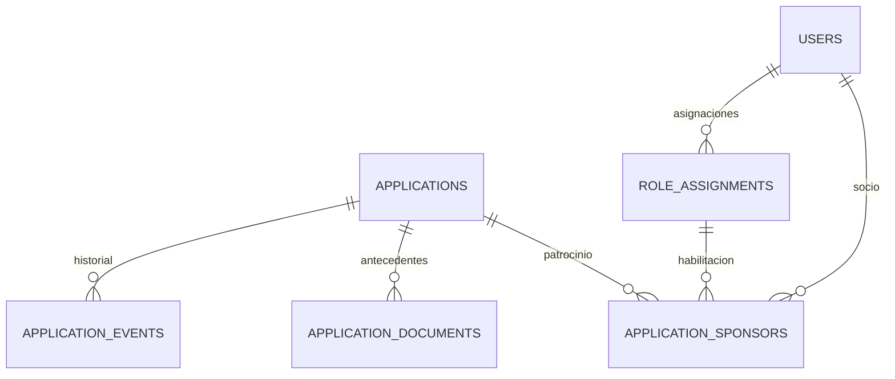

# Modelo de postulaciones

## Identificadores y referencia

Se conserva **varchar(36)** para las entidades heredadas referenciadas por el Modelo 02: usuarios, organizaciones, comisiones y recursos. Laravel genera UUID como texto para sus identificadores, preservando el tipo SQL de las claves. Las nuevas entidades del Modelo 02 y de postulaciones usan el tipo SQL **UUID**.

La base no transforma users.id UUID de una base existente. Esa adaptación requiere revisar su esquema y sus datos. Tampoco incorpora las migraciones genéricas de roles del ZIP anterior.

El archivo database/reference/modelo-02-catalogo-roles-alineado-v1.0.sql es una copia literal del recibido. Laravel aporta la transacción y limita search_path a ella; se crea un ámbito global. Una migración separada implementa la correspondencia rol/ámbito señalada en el propio SQL.

## Tablas nuevas: cchia_admissions

| Tabla | Contenido | Relaciones |
|---|---|---|
| applications | Folio, hash de seguimiento, vínculo y personería, identidad personal u organizacional, representante, correo, domicilio, actividad IA, estado, revisión de datos, versión de reglas y campos para una futura resolución. | Tiene documentos, patrocinadores y eventos. El futuro responsable de resolución referencia public.users. |
| application_documents | Tipo, clave privada, nombre original saneado, MIME, tamaño, SHA-256 y fecha. | Pertenece a una solicitud. La API no entrega su clave de almacenamiento. |
| application_sponsors | Socio, asignación que lo habilitaba, posición 1/2 y fecha de comprobación. | Referencia solicitud, public.users y cchia_m02.role_assignments. No repite socio ni posición por solicitud. |
| application_events | Actor, clase de actor, acción, resultado, fecha y metadatos mínimos. | Historial de la solicitud. Un trigger impide modificar o borrar eventos mediante DML normal. |

## Reglas de la base

- Se conservan los códigos del prototipo: member/collaborator y natural/juridica, como dos decisiones independientes.
- Persona natural: nombre e identificación. Persona jurídica: organización y representante. Un check SQL impide mezclar ambos grupos.
- Para persona jurídica: vigencia, personería y estatutos **o** inicio de actividades. La última categoría utiliza la clave técnica estatutos. Se comprueban dos socios distintos con rol socio global activo, no revocado y vigente al presentar la solicitud.
- La asignación comprobada permanece como evidencia; una revocación posterior no borra el patrocinio histórico.
- Los checks diferidos exigen antecedentes y patrocinadores completos al confirmar la transacción. Los documentos y patrocinios confirmados no se actualizan: una sustitución requiere un flujo versionado posterior.
- PDF/JPG/PNG y 5 MB son decisiones técnicas propuestas del prototipo. El tamaño se puede reducir por configuración; aumentarlo requiere revisar también el límite SQL.
- El envío crea estado received. No crea usuarios, roles ni membresía.
- La declaración de revisión de datos no reemplaza un consentimiento o política institucional.
- Los campos de resolución están preparados; aprobar/rechazar y calcular 30 días hábiles siguen pendientes del flujo y calendario institucionales.

La ruta de colaborador jurídico está deshabilitada por defecto. Si se confirma que utiliza los mismos antecedentes de RF-04, puede habilitarse por configuración. Si sus reglas difieren, deben implementarse antes de activarla. La recepción de un colaborador natural no aprueba su modelo de colaboración o NDA.

Se añaden al catálogo los permisos propuestos admissions.read y admissions.documents.read, **sin asignarlos a roles o usuarios**. El acceso institucional exige además configuración habilitada, asignación Directorio global efectiva y permiso explícito. Las asignaciones de las pruebas son ficticias.

companies, commissions y resources son contratos mínimos para las claves foráneas del SQL recibido. No constituyen módulos funcionales de organizaciones, comisiones o recursos. El historial protegido frente a DML normal no es una garantía de inmutabilidad frente al propietario o administrador de la base.
